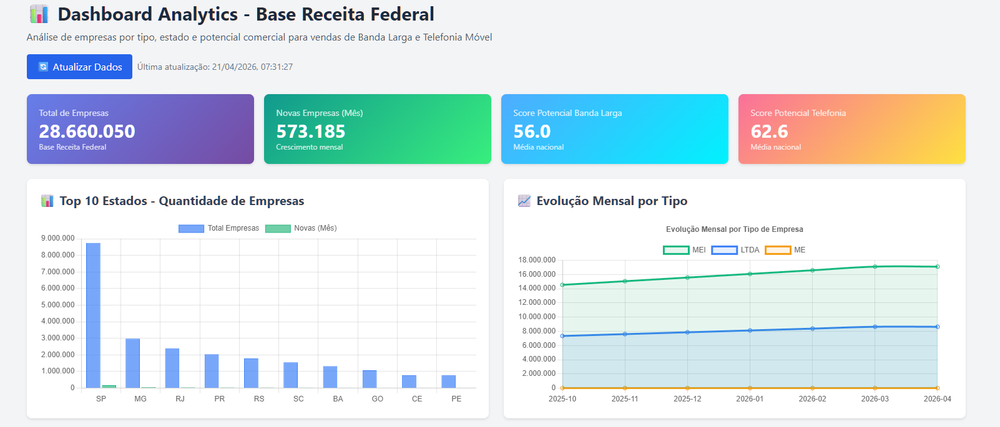
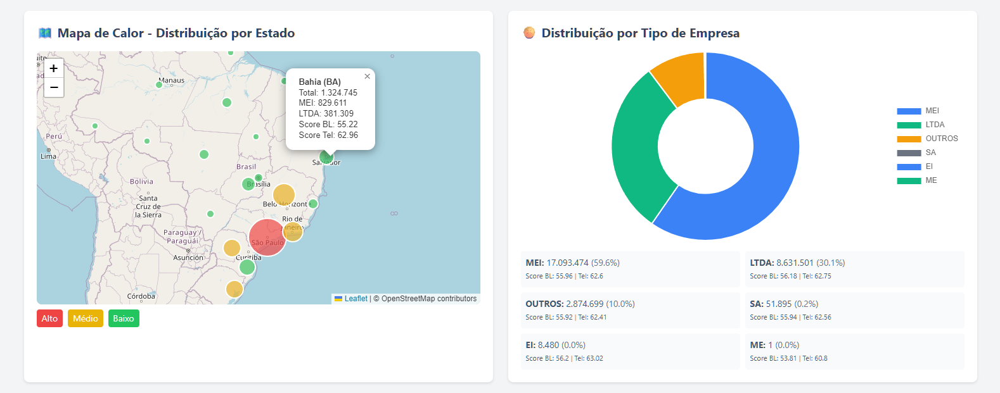
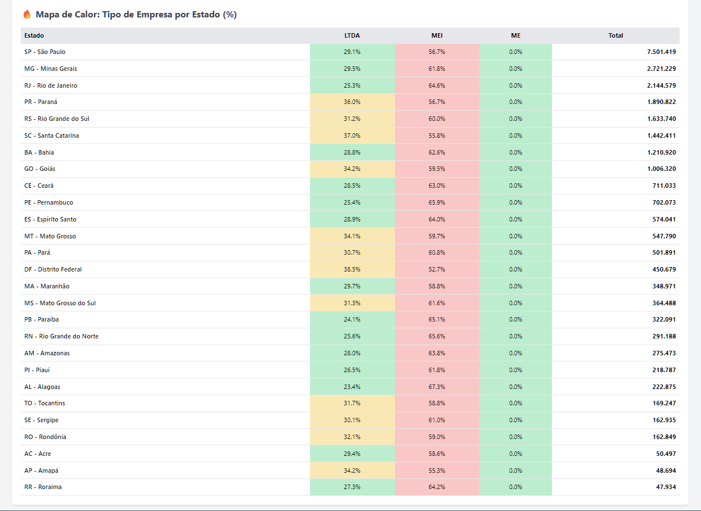
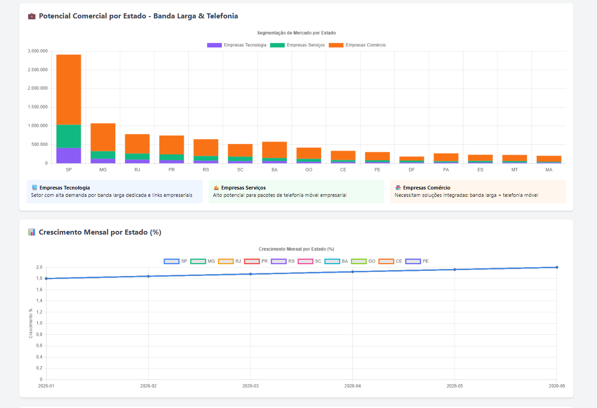
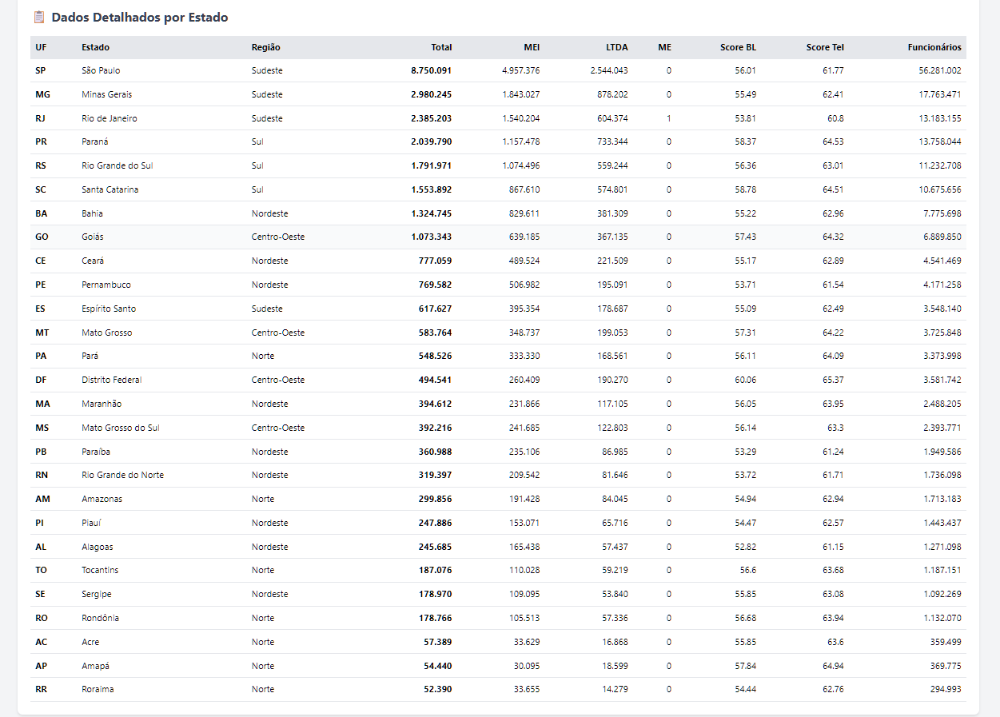

# 📊 Dashboard Analytics - Empresas Receita Federal

Sistema de analytics completo para análise de empresas com foco em potencial comercial para vendas de **Banda Larga** e **Telefonia Móvel**.

## 📊 Dashboard Analytics em Destaque

O projeto conta com um dashboard interativo (com **Modo Escuro** e **Filtros por Região**), para visualização assertiva da inteligência comercial.

### KPIs e Evolução Mensal


### Distribuição Geográfica e Tipos de Empresa


### Análise de Mercado por Estado (%)


### Potencial Comercial de Vendas (Banda Larga e Telefonia)


### Dados Detalhados por Estado


---

## 🎯 Funcionalidades

### Métricas Principais
- **Total de empresas** por estado e tipo (LTDA, MEI, ME, EIRELI, SA)
- **Evolução mensal** com crescimento e tendências
- **Mapa de calor** - distribuição geográfica de empresas
- **Potencial comercial** - scoring por segmento de mercado
- **Crescimento mensal** por estado e tipo

### Gráficos Disponíveis
1. **Barras** - Top 10 estados por quantidade
2. **Linha** - Evolução mensal por tipo de empresa
3. **Pizza/Doughnut** - Distribuição percentual por tipo
4. **Mapa** - Distribuição geográfica com heatmap
5. **Stacked Bars** - Potencial comercial por segmento
6. **Heatmap Table** - Tipo de empresa por estado (%)
7. **Multi-line** - Crescimento mensal comparativo

### KPIs de Vendas
- **Score Potencial Banda Larga** (0-100)
- **Score Potencial Telefonia** (0-100)
- **Empresas de Tecnologia** (alto potencial BL)
- **Empresas de Serviços** (alto potencial Telefonia)
- **Empresas de Comércio** (pacotes integrados)
- **Total de funcionários estimado**

## 🚀 Como Usar

### 1. Primeira Execução (Setup)

```bash
# Cria schema, tabelas e views no PostgreSQL
python run_dashboard.py --setup

# Processa dados dos Parquets e popula tabelas
python run_dashboard.py --update
```

### 2. Iniciar Dashboard

```bash
# Modo padrão - apenas inicia o servidor web
python run_dashboard.py

# Acesse: http://localhost:5001
```

### 3. Modo Completo (Setup + Update + Run)

```bash
python run_dashboard.py --full
```

## 📁 Estrutura de Arquivos

```
src/analytics/
├── schema_analytics.sql          # Schema do banco (tabelas, views, índices)
├── analytics_processor.py        # Processador de dados (Parquet → PostgreSQL)
├── dashboard_api.py              # API Flask (endpoints REST)
├── dashboard_templates/
│   └── index.html               # Dashboard web (HTML + Chart.js + Leaflet)
└── README.md                     # Este arquivo
```

## 🗄️ Schema do Banco

### Tabelas Dimensionais
- `dim_tempo` - Períodos mensais
- `dim_localizacao` - Estados brasileiros com coordenadas
- `dim_tipo_empresa` - Categorias (LTDA, MEI, ME, etc)

### Tabelas Fato
- `fato_empresas` - Métricas principais por período/estado/tipo
- `fato_evolucao_mensal` - Evolução com crescimento percentual

### Views para Dashboard
- `vw_resumo_estado` - Resumo por estado
- `vw_evolucao_mensal` - Série temporal
- `vw_mapa_tipo_estado` - Mapa de calor
- `vw_top_estados` - Ranking
- `vw_potencial_comercial` - Métricas de vendas

## 🔌 API Endpoints

| Endpoint | Descrição |
|----------|-----------|
| `GET /` | Dashboard web |
| `GET /api/resumo-geral` | KPIs gerais |
| `GET /api/por-estado` | Dados por estado |
| `GET /api/evolucao-mensal` | Série temporal |
| `GET /api/por-tipo` | Distribuição por tipo |
| `GET /api/mapa-tipo-estado` | Heatmap dados |
| `GET /api/potencial-comercial` | Métricas de vendas |
| `GET /api/crescimento-por-estado` | Crescimento mensal |
| `POST /api/atualizar-dados` | Atualiza dados |

## 📊 Algoritmo de Scoring

### Categorização de Empresas
```python
# Natureza Jurídica → Categoria
2135 → MEI
2062, 2254 → LTDA
2046 → SA
2214 → EIRELI
# ... etc
```

### Cálculo de Score (0-100)

**Score Banda Larga:**
- Base LTDA: 85
- Base MEI: 40
- Base ME: 60
- +15 se CNAE em Tecnologia
- +10 se CNAE em Serviços

**Score Telefonia:**
- Base LTDA: 80
- Base MEI: 50
- Base ME: 65
- +10 se CNAE em Tecnologia
- +15 se CNAE em Serviços
- +10 se CNAE em Comércio

### Estimativa de Funcionários
```
MEI  → 1 funcionário
ME   → 5 funcionários
EPP  → 15 funcionários
Outros → 50 funcionários
```

## 🔄 Atualização de Dados

O sistema suporta atualização incremental mensal:

1. Execute o ETL normalmente para baixar novos dados
2. Rode o processor: `python run_dashboard.py --update`
3. O sistema automaticamente:
   - Cria novo período em `dim_tempo`
   - Processa empresas e estabelecimentos
   - Calcula evolução vs mês anterior
   - Atualiza todos os gráficos

## 🛠️ Dependências

```bash
pip install flask flask-cors sqlalchemy pandas pyarrow
```

Já inclusas no projeto:
- SQLAlchemy
- Pandas
- PyArrow
- Flask (para o dashboard)

## 📈 Próximos Passos / Roadmap

- [ ] Exportar relatórios em PDF/Excel
- [ ] Alertas automáticos de crescimento
- [ ] Comparação entre períodos
- [ ] Previsões com ML
- [ ] Integração com APIs externas (IBGE, ANATEL)
- [ ] Autenticação e controle de acesso

## 📞 Suporte

Para dúvidas ou problemas:
1. Verifique se o PostgreSQL está rodando: `docker ps`
2. Teste conexão: `python -c "from src.utils.env_loader import config; print(config.DATABASE_URL)"`
3. Verifique logs do ETL: `docs/logs/pipeline.log`

---
**Desenvolvido para:** Sistema ETL Receita Federal  
**Versão:** 1.0.0  
**Data:** 2026-04-20
